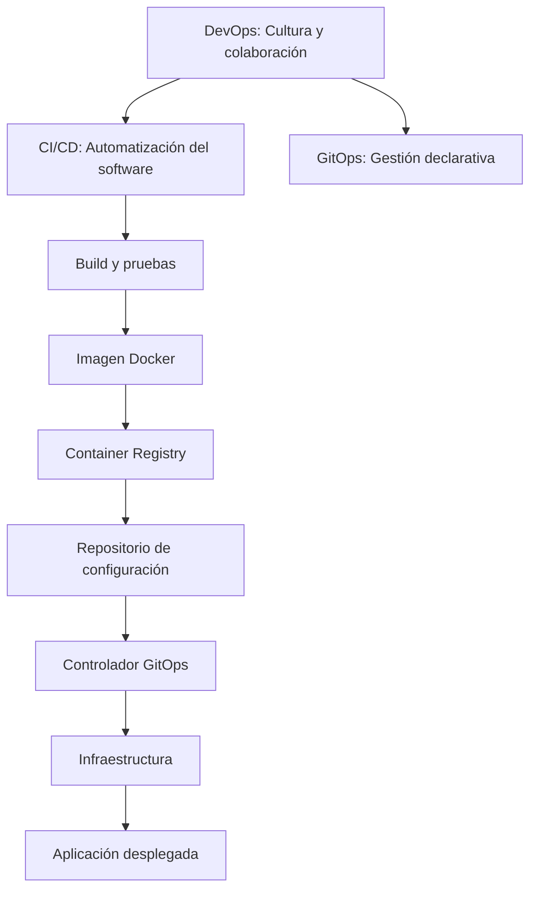
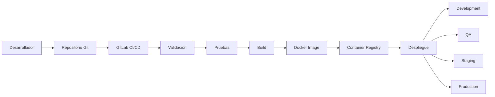
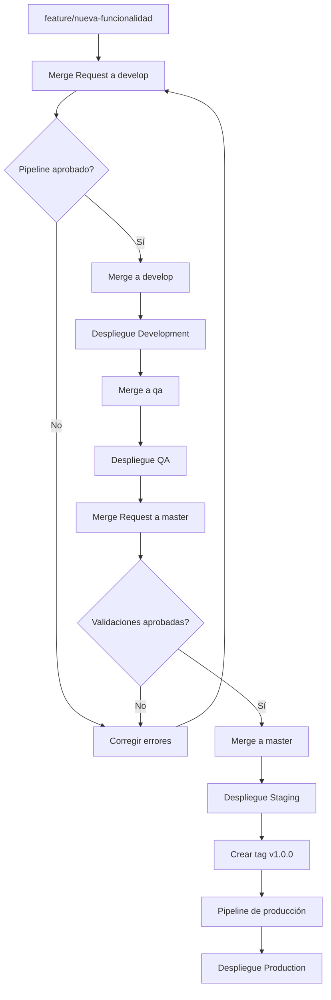
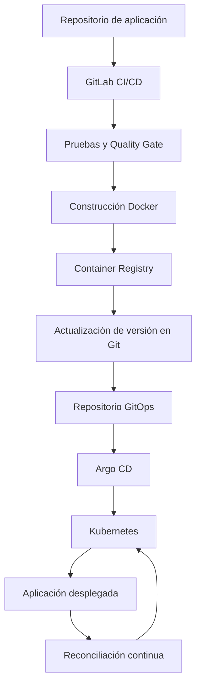
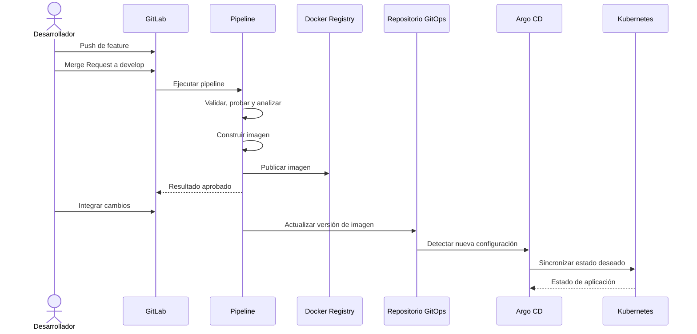
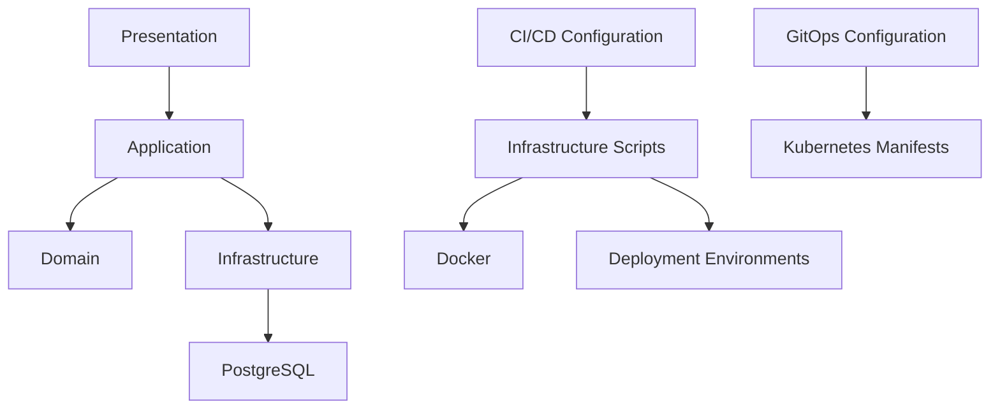

# CI/CD: Integración y Despliegue Continuo
## Automatización de pipelines y cultura GitOps


## 1. Información general

**Tema:** CI/CD (Integración y Despliegue Continuo): Automatización de pipelines y cultura GitOps.

**Proyecto práctico:** Sistema de gestión de inventario.

**Herramienta principal de automatización:** GitLab CI/CD.

**Tecnologías complementarias:** Git, Docker, PostgreSQL, Jenkins, SonarQube y Argo CD.

**Propósito:** Investigar, comprender y demostrar cómo se automatiza el ciclo de vida del desarrollo de software mediante pipelines de integración y despliegue continuo, aplicando prácticas DevOps y principios GitOps.

El proyecto contempla una aplicación funcional con operaciones CRUD para dos entidades, un proceso automatizado de validación del código y cuatro ambientes independientes: desarrollo, QA, staging y producción.

---

## 2. Objetivos

### Objetivo general

Investigar e implementar un proceso de integración y despliegue continuo que permita automatizar la construcción, validación, análisis, empaquetado y despliegue de aplicaciones, incorporando los principios de GitOps para garantizar entregas controladas, reproducibles y trazables.

### Objetivos específicos

- Comprender los conceptos de integración continua, entrega continua y despliegue continuo.
- Investigar la evolución de las prácticas CI/CD y su relación con DevOps.
- Identificar los componentes necesarios para construir un pipeline.
- Analizar herramientas como GitLab CI/CD, GitHub Actions y Jenkins.
- Comprender los conceptos de stages, jobs, steps, runners, artifacts, environments, variables y secrets.
- Implementar validaciones automáticas de código y pruebas.
- Automatizar la construcción y publicación de imágenes Docker.
- Configurar despliegues independientes para desarrollo, QA, staging y producción.
- Aplicar controles de calidad y seguridad antes de permitir la integración de cambios.
- Comprender y aplicar los principios de GitOps.
- Relacionar CI/CD y GitOps con principios SOLID, atributos de calidad, tácticas y patrones arquitectónicos.

---

# PARTE I. INVESTIGACIÓN

## 3. ¿Qué es CI/CD?

CI/CD es un conjunto de prácticas y procesos de ingeniería de software que permiten automatizar las actividades necesarias para integrar cambios en el código, verificar su funcionamiento y entregar nuevas versiones de una aplicación.

Su propósito es reducir los errores humanos, acelerar las entregas, mejorar la calidad del software y proporcionar mecanismos confiables para llevar los cambios desde el entorno de desarrollo hasta producción.

CI/CD se divide en tres conceptos fundamentales:

### 3.1 Integración continua (Continuous Integration - CI)

Es una práctica mediante la cual los desarrolladores integran frecuentemente sus cambios en un repositorio compartido.

Cada modificación puede activar automáticamente un pipeline encargado de:

- Descargar el código fuente.
- Instalar dependencias.
- Compilar la aplicación.
- Ejecutar pruebas unitarias.
- Realizar análisis estático de código.
- Detectar posibles vulnerabilidades.
- Validar los criterios de calidad.

El propósito es detectar problemas lo antes posible, evitando que los errores se acumulen hasta etapas avanzadas del proyecto.

**Ejemplo:** Un desarrollador crea una rama `feature/productos`, modifica el módulo de productos y abre un Merge Request hacia `develop`. GitLab ejecuta automáticamente las validaciones. Si alguna falla, el cambio no debe integrarse.

### 3.2 Entrega continua (Continuous Delivery - CD)

Consiste en mantener el software en condiciones de ser desplegado en producción en cualquier momento.

Después de superar las validaciones de integración continua, la aplicación puede:

- Construirse como una imagen Docker.
- Publicarse en un registro de contenedores.
- Desplegarse en desarrollo.
- Promoverse hacia QA y staging.
- Quedar preparada para producción.

La entrega a producción puede requerir una aprobación manual.

### 3.3 Despliegue continuo (Continuous Deployment - CD)

Es una práctica en la que cada cambio que supera satisfactoriamente todas las validaciones y políticas establecidas se despliega automáticamente en producción.

No requiere una aprobación manual individual para cada versión.

**Diferencia fundamental:**

| Concepto | Característica |
|---|---|
| Integración continua | Automatiza la integración y validación del código. |
| Entrega continua | Mantiene versiones listas para desplegarse. |
| Despliegue continuo | Publica automáticamente los cambios aprobados en producción. |

## 4. Características principales de CI/CD

1. **Automatización:** Reduce las tareas manuales durante la construcción, validación y publicación del software.
2. **Integración frecuente:** Facilita la incorporación de cambios pequeños y controlados.
3. **Validación automática:** Ejecuta pruebas y verificaciones antes de aceptar modificaciones.
4. **Trazabilidad:** Permite identificar qué modificación, versión y ejecución generó un despliegue.
5. **Reproducibilidad:** Utiliza configuraciones y procesos versionados.
6. **Control de calidad:** Establece condiciones mínimas para aceptar código.
7. **Despliegues controlados:** Permite separar los ambientes y establecer permisos.
8. **Retroalimentación rápida:** Informa a los desarrolladores cuando un cambio presenta problemas.

## 5. Historia y evolución

La evolución de CI/CD está relacionada con los cambios en las metodologías de desarrollo y administración de infraestructura.

| Periodo | Evolución |
|---|---|
| Décadas de 1970-1990 | Desarrollo mediante procesos principalmente manuales, compilaciones y entregas poco frecuentes. |
| Finales de los 90 | Se popularizan las prácticas de integración frecuente y automatización de compilaciones. |
| Década de 2000 | Se extienden las herramientas de integración continua y las pruebas automatizadas. |
| 2010-2015 | DevOps impulsa la colaboración entre desarrollo y operaciones, junto con la automatización del despliegue. |
| 2015-2020 | Docker, Kubernetes y los servicios cloud facilitan los despliegues automatizados y reproducibles. |
| 2020-actualidad | Se consolidan GitOps, infraestructura como código, seguridad integrada, observabilidad y políticas automatizadas. |

La evolución no representa la desaparición de las herramientas anteriores, sino la incorporación progresiva de nuevas capacidades de automatización, seguridad y gestión de infraestructura.

## 6. Ventajas y desventajas

### Ventajas

- Disminución de errores durante los despliegues.
- Detección temprana de defectos.
- Entregas más rápidas y frecuentes.
- Mayor consistencia entre ambientes.
- Reducción de tareas repetitivas.
- Mejor colaboración entre desarrollo, QA y operaciones.
- Trazabilidad de cambios y versiones.
- Facilidad para recuperar versiones anteriores.
- Mayor control sobre la calidad del producto.

### Desventajas

- Requiere inversión inicial de configuración.
- Necesita conocimientos sobre automatización e infraestructura.
- Los pipelines complejos pueden requerir mantenimiento.
- Las pruebas deficientes pueden generar una falsa sensación de seguridad.
- Los secretos y permisos deben administrarse cuidadosamente.
- Los runners y servidores pueden convertirse en puntos de congestión.
- Una configuración incorrecta puede propagar errores entre ambientes.

## 7. Casos de uso

CI/CD puede utilizarse en diferentes situaciones:

| Situación o problema | Aplicación de CI/CD |
|---|---|
| Varios desarrolladores trabajan simultáneamente. | Validación automática de cambios mediante Merge Requests. |
| Se presentan errores al integrar código. | Ejecución de pruebas antes de aceptar modificaciones. |
| Los despliegues manuales son lentos. | Automatización del proceso de publicación. |
| Los ambientes tienen configuraciones diferentes. | Uso de variables y configuraciones por ambiente. |
| Se introducen vulnerabilidades. | Análisis estático, análisis de dependencias y detección de secretos. |
| Se necesitan publicar versiones frecuentes. | Construcción y despliegue automatizado. |
| Se necesita recuperar una versión anterior. | Versionamiento de imágenes y rollback. |

## 8. Casos de aplicación en la industria

### Netflix

Netflix utiliza prácticas de entrega continua y automatización para facilitar la evolución de sus servicios y realizar despliegues frecuentes, apoyándose en mecanismos de resiliencia y observabilidad.

### Amazon

Amazon ha impulsado prácticas de automatización, despliegue frecuente y entrega de software mediante procesos que reducen la intervención manual y permiten gestionar cambios de manera controlada.

### Google

Google utiliza prácticas de ingeniería de confiabilidad, automatización, pruebas y gestión de infraestructura para mantener sus sistemas y servicios a gran escala.

### GitLab

GitLab integra repositorios, control de versiones, pipelines, registro de contenedores, gestión de ambientes y funcionalidades de seguridad en una misma plataforma.

Estos ejemplos muestran que CI/CD no es exclusivo de una herramienta: es una práctica que puede implementarse con diferentes tecnologías y arquitecturas.

---

# PARTE II. ELEMENTOS DE UN PIPELINE

## 9. ¿Qué es un pipeline?

Un pipeline es una secuencia automatizada de actividades que se ejecutan cuando ocurre un evento determinado dentro del proceso de desarrollo.

Por ejemplo:

1. Un desarrollador realiza un commit.
2. El repositorio recibe los cambios.
3. Se activa un pipeline.
4. Se verifica el código.
5. Se ejecutan pruebas.
6. Se construye la aplicación.
7. Se crea una imagen Docker.
8. Se publica la imagen en un registro.
9. Se despliega en el ambiente correspondiente.

### 9.1 Componentes fundamentales

| Elemento | Definición | Función |
|---|---|---|
| Repositorio Git | Almacén del código fuente y su historial. | Mantener versiones y controlar cambios. |
| Pipeline | Flujo automatizado de actividades. | Coordinar el proceso CI/CD. |
| Stage | Etapa lógica del pipeline. | Agrupar actividades relacionadas. |
| Job | Unidad de ejecución dentro de un stage. | Ejecutar una tarea concreta. |
| Step | Instrucción o acción dentro de un job. | Ejecutar comandos específicos. |
| Runner | Agente que ejecuta los jobs. | Proporcionar capacidad de ejecución. |
| Build | Proceso de construcción. | Generar una aplicación ejecutable. |
| Artifact | Archivo generado durante el pipeline. | Compartir resultados entre etapas. |
| Container Registry | Almacén de imágenes de contenedores. | Guardar y distribuir imágenes Docker. |
| Environment | Ambiente de ejecución. | Separar desarrollo, QA, staging y producción. |
| Variables | Valores de configuración. | Adaptar el comportamiento del pipeline. |
| Secrets | Datos confidenciales. | Proteger credenciales y accesos. |

### 9.2 Diferencia entre Stage, Job y Step

Es importante no confundir estos conceptos:

- **Stage:** representa una fase del proceso.
- **Job:** representa una tarea que se ejecuta dentro de una fase.
- **Step:** representa una instrucción o acción realizada por un job.

Ejemplo:

```yaml
stages:
  - validate
  - test
  - build

validate_code:
  stage: validate
  script:
    - echo "Validando código"
    - echo "Revisando formato"

run_tests:
  stage: test
  script:
    - echo "Ejecutando pruebas"

build_application:
  stage: build
  script:
    - echo "Construyendo aplicación"
```

En este ejemplo existen tres stages y tres jobs. Los comandos de cada bloque `script` son los steps ejecutados por el job.

### 9.3 ¿Qué es un Runner?

Es el componente encargado de ejecutar los trabajos definidos en el pipeline.

Puede utilizar diferentes ejecutores, como:

- Docker.
- Shell.
- Kubernetes.

El runner recibe un job, obtiene el código necesario, ejecuta las instrucciones y devuelve el resultado.

### 9.4 ¿Qué es un Artifact?

Es un archivo generado durante una ejecución del pipeline que puede conservarse y utilizarse posteriormente.

Ejemplos:

- Reportes de pruebas.
- Archivos compilados.
- Resultados de análisis.
- Paquetes de publicación.

### 9.5 ¿Qué es un Environment?

Representa un ambiente donde se ejecuta una versión de la aplicación.

En este proyecto se utilizarán cuatro:

| Ambiente | Propósito |
|---|---|
| Development | Validar los cambios durante el desarrollo. |
| QA | Ejecutar pruebas funcionales y de calidad. |
| Staging | Simular las condiciones de producción. |
| Production | Ejecutar la versión disponible para los usuarios. |

### 9.6 Variables de entorno

Son valores configurables que permiten modificar el comportamiento de la aplicación sin cambiar su código fuente.

Ejemplos:

```env
ASPNETCORE_ENVIRONMENT=Development
DATABASE_HOST=postgres
DATABASE_NAME=inventario
API_PORT=8080
```

Cada ambiente puede utilizar diferentes valores.

### 9.7 Secrets

Son datos confidenciales que no deben almacenarse directamente en el código fuente.

Ejemplos:

- Contraseñas de bases de datos.
- Tokens de acceso.
- Claves privadas.
- Credenciales del registro Docker.
- Llaves SSH.

**Buenas prácticas:**

- Guardarlos en el administrador de variables protegidas de GitLab.
- Utilizar variables masked y protected cuando corresponda.
- No escribirlos directamente en archivos YAML.
- No imprimirlos en los logs.
- Limitar los permisos de acceso.
- Evitar que pipelines de ramas no confiables puedan acceder a credenciales de producción.

---

## 10. Herramientas utilizadas en CI/CD

### 10.1 GitLab CI/CD

Es una solución de integración y entrega continua integrada en GitLab.

Utiliza el archivo `.gitlab-ci.yml` para definir los stages, jobs, reglas de ejecución y despliegues.

Características:

- Integración con repositorios Git.
- Ejecución de pipelines mediante eventos.
- Administración de runners.
- Registro de contenedores.
- Gestión de variables y secretos.
- Administración de ambientes.
- Validación de Merge Requests.
- Integración con herramientas de seguridad.

Es la herramienta principal seleccionada para el proyecto.

### 10.2 Jenkins

Es una plataforma de automatización de código abierto utilizada para construir, probar y desplegar aplicaciones.

Características:

- Configuración mediante `Jenkinsfile`.
- Pipelines declarativos y programados.
- Arquitectura extensible mediante plugins.
- Integración con diferentes herramientas.
- Ejecución mediante agentes.

Jenkins es especialmente útil cuando se necesita personalizar la automatización o integrar herramientas y sistemas existentes.

### 10.3 GitHub Actions

Es el sistema de automatización integrado en GitHub.

Utiliza archivos YAML almacenados en:

```text
.github/workflows/
```

Características:

- Workflows activados mediante eventos.
- Jobs y steps.
- Actions reutilizables.
- Integración con repositorios GitHub.
- Ejecución en runners.
- Gestión de secretos.

### 10.4 Comparación de herramientas

| Característica | GitLab CI/CD | Jenkins | GitHub Actions |
|---|---|---|---|
| Configuración | YAML | Jenkinsfile | YAML |
| Integración con Git | Nativa | Mediante integraciones | Nativa |
| Código abierto | Sí, GitLab CE | Sí | Plataforma propietaria con componentes abiertos |
| Runners/agentes | GitLab Runner | Jenkins Agents | GitHub-hosted o self-hosted runners |
| Plugins y extensiones | Integraciones y componentes | Amplio ecosistema de plugins | Marketplace de Actions |
| Registro de contenedores | GitLab Container Registry | Integración externa | GitHub Container Registry |
| Gestión de ambientes | Sí | Mediante plugins y configuración | Mediante environments |
| Uso en el proyecto | Principal | Comparación | Comparación |

---

# PARTE III. GITOPS

## 11. ¿Qué es GitOps?

GitOps es un enfoque operativo que utiliza Git como fuente central de verdad para administrar la configuración y el estado deseado de los sistemas.

En lugar de realizar cambios directamente sobre la infraestructura, estos se declaran mediante archivos versionados en un repositorio.

Un agente automatizado observa el repositorio y compara el estado declarado con el estado real del sistema, aplicando las modificaciones necesarias.

### 11.1 Principios fundamentales

OpenGitOps establece cuatro principios:

1. **Declarativo:** el estado deseado debe describirse mediante configuraciones declarativas.
2. **Versionado e inmutable:** la configuración debe almacenarse en un sistema con historial de versiones.
3. **Obtención automática (Pull):** los agentes deben obtener automáticamente la configuración desde su fuente.
4. **Reconciliación continua:** los agentes deben comparar continuamente el estado real con el deseado y corregir diferencias.

### 11.2 ¿Cómo funciona GitOps?

1. El equipo modifica un archivo de configuración.
2. Se realiza un commit en Git.
3. Se abre un Merge Request.
4. Se revisan y aprueban los cambios.
5. Se integra la modificación.
6. Un controlador GitOps detecta la nueva configuración.
7. El controlador aplica los cambios al entorno.
8. Se verifica que el estado real coincida con el estado deseado.

### 11.3 CI/CD frente a GitOps

| CI/CD tradicional | GitOps |
|---|---|
| Automatiza construcción, pruebas y publicación. | Administra el estado deseado de la infraestructura y las aplicaciones. |
| Puede utilizar comandos de despliegue Push. | Utiliza agentes que obtienen la configuración mediante Pull. |
| Se activa mediante eventos del repositorio. | También realiza reconciliación continua. |
| Genera y publica artefactos. | Sincroniza configuraciones declarativas. |
| Puede desplegar mediante SSH, API o herramientas de infraestructura. | Normalmente utiliza controladores especializados. |

Ambos enfoques son complementarios.

**CI/CD construye y publica la versión; GitOps mantiene sincronizado el entorno con la configuración aprobada.**

### 11.4 Herramientas GitOps

- **Argo CD:** controlador que sincroniza aplicaciones declaradas en Git con clústeres Kubernetes.
- **Flux CD:** conjunto de herramientas para automatizar despliegues basados en Git.
- **Kubernetes:** plataforma para administrar aplicaciones contenerizadas.
- **Helm:** herramienta para empaquetar y administrar aplicaciones Kubernetes.
- **Kustomize:** herramienta para personalizar manifiestos Kubernetes.

### 11.5 Ventajas y desventajas de GitOps

**Ventajas:**

- Historial de cambios de infraestructura.
- Mayor trazabilidad.
- Configuraciones reproducibles.
- Detección de diferencias entre el estado real y el deseado.
- Facilita auditorías.
- Reduce modificaciones manuales.
- Permite recuperar configuraciones anteriores.

**Desventajas:**

- Requiere conocimientos de infraestructura declarativa.
- Necesita configurar y mantener controladores.
- Puede resultar complejo en arquitecturas pequeñas.
- La gestión de secretos requiere mecanismos adicionales.
- Una configuración incorrecta puede afectar múltiples recursos.

---

# PARTE IV. RELACIÓN ENTRE LOS TEMAS

## 12. Relación entre CI/CD, DevOps y GitOps

Los tres conceptos están relacionados, pero cumplen funciones diferentes.

- **DevOps:** cultura de colaboración entre desarrollo y operaciones, acompañada de automatización y responsabilidad compartida.
- **CI/CD:** prácticas y herramientas para integrar, validar, construir y entregar software.
- **GitOps:** enfoque para administrar y sincronizar el estado de los sistemas utilizando Git como fuente de verdad.

La relación puede representarse así:



## 13. ¿Qué tan común es el stack?

El ecosistema CI/CD tiene una presencia importante en la industria del software, especialmente en organizaciones que trabajan con servicios web, aplicaciones cloud, microservicios y despliegues frecuentes.

Las tecnologías seleccionadas responden a necesidades ampliamente conocidas:

| Tecnología | Uso principal | Relevancia |
|---|---|---|
| Git | Control de versiones | Fundamental |
| GitLab CI/CD | Automatización de pipelines | Alta |
| Jenkins | Automatización de procesos | Alta |
| Docker | Contenedores | Alta |
| Kubernetes | Orquestación | Alta en entornos cloud-native |
| SonarQube | Calidad y análisis estático | Complementaria |
| PostgreSQL | Base de datos relacional | Alta |
| Argo CD | GitOps | Especializada en Kubernetes |

La relevancia de cada tecnología depende del sector, tamaño de la empresa, arquitectura y plataforma utilizada.

---

## 14. Matriz de principios SOLID vs. CI/CD y GitOps

La relación entre SOLID y CI/CD es indirecta: SOLID orienta el diseño del software, mientras que CI/CD permite validar automáticamente parte de su cumplimiento.

| Principio | Relación con CI/CD | Relación con GitOps |
|---|---|---|
| SRP - Responsabilidad única | Facilita pruebas unitarias y análisis de código. | Permite separar responsabilidades en configuraciones. |
| OCP - Abierto/cerrado | Facilita agregar funcionalidades sin alterar componentes existentes. | Permite extender configuraciones mediante manifiestos. |
| LSP - Sustitución de Liskov | Se puede validar mediante pruebas automatizadas. | No tiene una relación directa; aplica al diseño de software. |
| ISP - Segregación de interfaces | Facilita pruebas y mantenimiento de componentes. | Favorece integraciones desacopladas. |
| DIP - Inversión de dependencias | Facilita pruebas independientes de infraestructura. | Permite desacoplar aplicaciones de detalles de despliegue. |

## 15. Matriz de atributos de calidad vs. temas

Escala: Alta, Media y Baja.

| Atributo de calidad | CI/CD | GitOps | Justificación |
|---|---|---|---|
| Mantenibilidad | Alta | Alta | Configuraciones y procesos versionados. |
| Confiabilidad | Alta | Alta | Validaciones y reconciliación. |
| Seguridad | Alta | Alta | Análisis y control de accesos. |
| Disponibilidad | Media-Alta | Alta | Automatización y recuperación de estados. |
| Escalabilidad | Media | Alta | Facilita administrar múltiples entornos y recursos. |
| Trazabilidad | Alta | Alta | Historial de cambios en Git. |
| Portabilidad | Alta | Alta | Uso de contenedores y configuraciones declarativas. |
| Rendimiento | Media | Media | Depende de la aplicación y de la infraestructura. |

## 16. Matriz de tácticas arquitectónicas vs. temas

| Táctica | CI/CD | GitOps |
|---|---|---|
| Automatización de pruebas | Alta | Media |
| Monitoreo | Alta | Alta |
| Detección de fallos | Alta | Alta |
| Recuperación y rollback | Alta | Alta |
| Control de acceso | Alta | Alta |
| Aislamiento de ambientes | Alta | Alta |
| Versionamiento | Alta | Alta |
| Replicación de infraestructura | Media | Alta |
| Validación de configuración | Alta | Alta |

### Tácticas más relevantes

- **Detección de errores:** ejecutar pruebas y análisis antes de integrar código.
- **Recuperación:** conservar versiones anteriores para realizar rollback.
- **Control de acceso:** proteger ramas, ambientes y credenciales.
- **Aislamiento:** mantener separados desarrollo, QA, staging y producción.
- **Monitoreo:** observar la salud de los servicios desplegados.

## 17. Matriz de patrones arquitectónicos vs. temas

| Patrón | Aplicación en CI/CD | Aplicación en GitOps |
|---|---|---|
| Pipeline | Organiza las actividades de construcción y validación. | Puede coordinar actualizaciones de configuración. |
| Repository | Administra el código fuente. | Mantiene manifiestos y configuraciones. |
| Infrastructure as Code | Automatiza la creación de infraestructura. | Permite declarar el estado deseado. |
| Observer | Permite reaccionar a eventos. | Detecta modificaciones y diferencias de estado. |
| Strategy | Permite elegir distintas estrategias de despliegue. | Permite configurar diferentes políticas de sincronización. |
| Adapter | Integra herramientas externas. | Conecta controladores y plataformas. |

## 18. Matriz de mercado laboral vs. temas

| Perfil profesional | Conocimientos relacionados | Actividades |
|---|---|---|
| DevOps Engineer | CI/CD, Git, Docker, infraestructura | Automatizar procesos de entrega. |
| Platform Engineer | Kubernetes, GitOps, cloud | Construir plataformas internas. |
| Cloud Engineer | Cloud, contenedores, IaC | Administrar infraestructura. |
| SRE | Observabilidad, disponibilidad, recuperación | Mejorar confiabilidad. |
| Backend Developer | Git, pruebas, pipelines | Desarrollar servicios integrables. |
| QA Automation Engineer | Testing, pipelines, calidad | Automatizar validaciones. |
| Security Engineer | SAST, secretos, dependencias | Integrar seguridad en el ciclo de desarrollo. |

Las competencias de CI/CD y GitOps son útiles tanto para perfiles especializados como para desarrolladores que participan en procesos de entrega de software.

---

# PARTE V. CASO PRÁCTICO

## 19. Descripción del proyecto

### Sistema de gestión de inventario

Se desarrollará una aplicación web para administrar productos y categorías mediante operaciones CRUD.

El propósito de este caso es demostrar cómo una aplicación funcional puede integrarse con un pipeline automatizado y desplegarse progresivamente en diferentes ambientes.

### Entidades

**Producto**

- Id
- Nombre
- Descripción
- Precio
- Stock
- CategoriaId

**Categoría**

- Id
- Nombre
- Descripción

### Operaciones CRUD

| Entidad | Operación | Descripción |
|---|---|---|
| Productos | Create | Registrar productos. |
| Productos | Read | Consultar productos. |
| Productos | Update | Modificar información. |
| Productos | Delete | Eliminar productos. |
| Categorías | Create | Registrar categorías. |
| Categorías | Read | Consultar categorías. |
| Categorías | Update | Modificar categorías. |
| Categorías | Delete | Eliminar categorías. |

### Stack tecnológico propuesto

| Componente | Tecnología |
|---|---|
| Backend | ASP.NET Core Web API |
| Frontend | Interfaz web |
| Base de datos | PostgreSQL |
| Control de versiones | Git |
| Automatización | GitLab CI/CD |
| Calidad | SonarQube |
| Contenedores | Docker |
| Registro de imágenes | GitLab Container Registry |
| Orquestación GitOps | Kubernetes + Argo CD |
| Infraestructura local | Docker Compose |

La implementación debe utilizar una misma versión de imagen para promover el artefacto entre ambientes, modificando únicamente su configuración.

---

## 20. Arquitectura de alto nivel

El sistema se organiza en cuatro grandes componentes:

1. Desarrolladores y repositorio Git.
2. Plataforma de automatización CI/CD.
3. Registro de imágenes.
4. Infraestructura de ejecución.



## 21. Flujo de trabajo Git

Se propone la siguiente estrategia de ramas:

| Rama | Función |
|---|---|
| `feature/*` | Desarrollo de nuevas funcionalidades. |
| `develop` | Integración continua y ambiente de desarrollo. |
| `qa` | Validación de calidad. |
| `master` | Preparación de versiones para staging. |
| Tags `v*` | Identificación y publicación de versiones de producción. |

### Flujo de trabajo

1. El desarrollador crea una rama `feature`.
2. Realiza los cambios y ejecuta pruebas locales.
3. Abre un Merge Request hacia `develop`.
4. GitLab ejecuta las validaciones.
5. Si se supera el Quality Gate, se permite integrar el cambio.
6. Al actualizarse `develop`, se despliega Development.
7. Al integrar cambios en `qa`, se despliega QA.
8. Al abrir un Merge Request hacia `master`, se ejecutan validaciones.
9. Al integrar los cambios en `master`, se despliega Staging.
10. Cuando se crea un tag de versión, se ejecuta el despliegue de producción.

**Importante:** GitLab utiliza el concepto de Merge Request (MR), equivalente funcional al Pull Request de GitHub.

### Diagrama del flujo de ramas



---

## 22. Diseño del pipeline

El pipeline se divide en las siguientes etapas:

| Stage | Actividades | Resultado esperado |
|---|---|---|
| Validate | Formato, lint y revisión de código. | Código válido. |
| Security | Detección de secretos y vulnerabilidades. | Validación de seguridad. |
| Test | Pruebas unitarias e integración. | Pruebas aprobadas. |
| Quality | Análisis estático y Quality Gate. | Calidad aceptada. |
| Build | Compilación de la aplicación. | Artefacto compilado. |
| Package | Construcción de imagen Docker. | Imagen disponible. |
| Publish | Publicación en Container Registry. | Imagen versionada. |
| Deploy Development | Despliegue automático. | Aplicación disponible en desarrollo. |
| Deploy QA | Despliegue automático. | Aplicación disponible para QA. |
| Deploy Staging | Despliegue automático. | Aplicación disponible para validación final. |
| Deploy Production | Despliegue mediante tag. | Versión publicada. |

### Quality Gate

Es un conjunto de condiciones que determinan si un cambio cumple los criterios mínimos de calidad.

Puede considerar:

- Errores de análisis estático.
- Vulnerabilidades.
- Cobertura de pruebas.
- Problemas de mantenibilidad.
- Detección de secretos.

Si no se cumplen las condiciones definidas, el pipeline debe detenerse y evitar la integración o promoción del cambio.

---

## 23. Ejemplo de configuración GitLab CI/CD

Archivo principal:

`.gitlab-ci.yml`

El siguiente ejemplo representa la estructura propuesta. Los scripts de compilación, pruebas y despliegue deben implementarse según la aplicación y la infraestructura seleccionadas.

```yaml
stages:
  - validate
  - security
  - test
  - quality
  - build
  - publish
  - deploy

variables:
  IMAGE_NAME: "$CI_REGISTRY_IMAGE"
  IMAGE_TAG: "$CI_COMMIT_SHA"

validate:
  stage: validate
  script:
    - echo "Validando estructura y formato"
    - ./scripts/validate.sh

security:
  stage: security
  script:
    - echo "Ejecutando validaciones de seguridad"
    - ./scripts/security-check.sh

test:
  stage: test
  script:
    - echo "Ejecutando pruebas automatizadas"
    - ./scripts/test.sh

quality:
  stage: quality
  script:
    - echo "Ejecutando análisis estático"
    - ./scripts/quality-check.sh

build:
  stage: build
  script:
    - docker build -t "$IMAGE_NAME:$IMAGE_TAG" .

publish:
  stage: publish
  script:
    - docker login -u "$CI_REGISTRY_USER" -p "$CI_REGISTRY_PASSWORD" "$CI_REGISTRY"
    - docker push "$IMAGE_NAME:$IMAGE_TAG"
  rules:
    - if: '$CI_COMMIT_BRANCH'

deploy_development:
  stage: deploy
  environment:
    name: development
  script:
    - ./scripts/deploy.sh development "$IMAGE_TAG"
  rules:
    - if: '$CI_COMMIT_BRANCH == "develop"'

deploy_qa:
  stage: deploy
  environment:
    name: qa
  script:
    - ./scripts/deploy.sh qa "$IMAGE_TAG"
  rules:
    - if: '$CI_COMMIT_BRANCH == "qa"'

deploy_staging:
  stage: deploy
  environment:
    name: staging
  script:
    - ./scripts/deploy.sh staging "$IMAGE_TAG"
  rules:
    - if: '$CI_COMMIT_BRANCH == "master"'

deploy_production:
  stage: deploy
  environment:
    name: production
  script:
    - ./scripts/deploy.sh production "$IMAGE_TAG"
  rules:
    - if: '$CI_COMMIT_TAG'
      when: manual
```

**Consideraciones importantes:**

- Los runners deben estar configurados y disponer de los ejecutores necesarios.
- Los scripts deben existir en el repositorio.
- El runner debe tener permisos para construir y publicar imágenes.
- Las credenciales deben configurarse como variables protegidas.
- El análisis de SonarQube debe esperar y verificar el resultado real del Quality Gate.
- La imagen debe construirse una vez y promoverse por su identificador inmutable.
- Los despliegues deben utilizar permisos y variables independientes.
- Producción debe utilizar tags protegidos y aprobación según la política definida.

Este YAML es una plantilla de referencia y no una configuración lista para ejecutar sin implementar los scripts y preparar los runners.

---

## 24. Estrategias de despliegue

Existen diferentes estrategias para publicar nuevas versiones de una aplicación.

### Recreate

Se detiene la versión anterior y posteriormente se inicia la nueva.

Ventaja: simplicidad.

Desventaja: puede existir indisponibilidad durante el cambio.

### Rolling Update

La nueva versión reemplaza progresivamente las instancias anteriores.

Ventaja: reduce interrupciones.

Desventaja: requiere controlar la compatibilidad entre versiones.

### Blue-Green Deployment

Se mantienen dos ambientes:

- Blue: versión actual.
- Green: versión nueva.

Cuando Green supera las verificaciones, se cambia el tráfico hacia ella.

Ventaja: facilita la reversión.

Desventaja: requiere recursos adicionales.

### Canary Deployment

Se publica la nueva versión inicialmente para una pequeña proporción del tráfico.

Si funciona correctamente, se aumenta progresivamente la cantidad de usuarios.

Ventaja: permite detectar problemas antes de afectar a todos los usuarios.

Desventaja: requiere monitoreo y control del tráfico.

---

## 25. Docker y contenedores

Docker permite empaquetar la aplicación y sus dependencias en una imagen que puede ejecutarse de manera consistente en diferentes ambientes.

### Dockerfile de referencia

```dockerfile
FROM mcr.microsoft.com/dotnet/sdk:10.0 AS build
WORKDIR /src

COPY . .
RUN dotnet restore
RUN dotnet publish -c Release -o /app/publish

FROM mcr.microsoft.com/dotnet/aspnet:10.0
WORKDIR /app

COPY --from=build /app/publish .
EXPOSE 8080

ENTRYPOINT ["dotnet", "Inventario.Api.dll"]
```

El nombre de la DLL y la configuración de puertos deben coincidir con el proyecto real.

### Docker Compose

Se utilizará Docker Compose para facilitar la ejecución local de la aplicación y PostgreSQL.

```yaml
services:
  api:
    build: .
    ports:
      - "8080:8080"
    environment:
      ASPNETCORE_ENVIRONMENT: Development
      ConnectionStrings__DefaultConnection: Host=db;Port=5432;Database=inventario;Username=app;Password=${DB_PASSWORD}
    depends_on:
      db:
        condition: service_healthy

  db:
    image: postgres:17
    environment:
      POSTGRES_DB: inventario
      POSTGRES_USER: app
      POSTGRES_PASSWORD: ${DB_PASSWORD}
    volumes:
      - postgres_data:/var/lib/postgresql/data
    healthcheck:
      test: ["CMD-SHELL", "pg_isready -U app -d inventario"]
      interval: 10s
      timeout: 5s
      retries: 5

volumes:
  postgres_data:
```

La contraseña debe definirse mediante un archivo `.env` local que no se suba al repositorio.

---

## 26. Arquitectura GitOps propuesta

Para demostrar GitOps de manera completa, se propone utilizar Argo CD y Kubernetes.

La separación será:

**Repositorio de aplicación:**
- Código fuente.
- Pruebas.
- Dockerfile.
- Pipeline CI/CD.

**Repositorio de configuración:**
- Manifiestos Kubernetes.
- Configuraciones de ambientes.
- Referencias a versiones de imágenes.
- Configuración declarativa de Argo CD.

El pipeline construye y publica la imagen. Posteriormente, una actualización aprobada en el repositorio de configuración permite que Argo CD sincronice el estado deseado.



Un despliegue mediante comandos SSH desde un pipeline puede ser automatizado, pero no constituye por sí solo una implementación completa de GitOps. Para ello se necesita la gestión declarativa y la reconciliación continua.

---

# PARTE VI. MODELOS Y DIAGRAMAS

## 27. Modelo C4

El modelo C4 permite documentar la arquitectura desde diferentes niveles de abstracción.

Para este proyecto se utilizarán:

1. Diagrama de contexto.
2. Diagrama de contenedores.
3. Diagrama dinámico.
4. Diagrama de despliegue.

### 27.1 Diagrama de contexto

Representa la interacción de los usuarios y sistemas externos con el sistema de inventario.

Elementos:

- Desarrollador.
- Usuario administrador.
- Sistema de inventario.
- GitLab.
- Registro Docker.

### 27.2 Diagrama de contenedores

Representa los principales componentes ejecutables:

- Aplicación web.
- API REST.
- Base de datos PostgreSQL.
- GitLab CI/CD.
- Docker Registry.
- Controlador GitOps.

### 27.3 Diagrama dinámico

Representa el recorrido de una modificación desde el desarrollo hasta el despliegue.



### 27.4 Diagrama de despliegue

Representa la infraestructura física o lógica en la que se ejecuta el proyecto.

Elementos:

- Máquina de desarrollo.
- Máquina de QA.
- Máquina de staging.
- Máquina de producción.
- Runner CI/CD.
- Docker Registry.
- Clúster Kubernetes, si se utiliza el componente GitOps completo.

## 28. Diagrama UML de paquetes

La aplicación se organizará por responsabilidades:



**Descripción de paquetes:**

| Paquete | Responsabilidad |
|---|---|
| Presentation | Controladores y endpoints de la API. |
| Application | Casos de uso y lógica de aplicación. |
| Domain | Entidades y reglas de negocio. |
| Infrastructure | Acceso a datos y servicios externos. |
| CI/CD Configuration | Definición del pipeline. |
| Infrastructure Scripts | Automatización de construcción y despliegue. |
| GitOps Configuration | Estado deseado de la infraestructura. |

---

# PARTE VII. IMPLEMENTACIÓN Y DESPLIEGUE

## 29. Requisitos previos

Para ejecutar el proyecto se necesitará:

- Git.
- Docker Desktop o Docker Engine.
- Docker Compose.
- .NET SDK 10.
- PostgreSQL, si se ejecuta fuera de Docker.
- Cuenta de GitLab.
- Repositorio Git.
- GitLab Runner.
- Acceso al Container Registry.

Para la demostración GitOps completa también se requiere un entorno Kubernetes y Argo CD.

## 30. Clonar el repositorio

```bash
git clone <URL_DEL_REPOSITORIO>
cd presentacion-adicional
```

## 31. Configurar variables de entorno

Crear un archivo `.env` local:

```env
DB_PASSWORD=contraseña_local_de_desarrollo
```

No publicar este archivo ni utilizar credenciales reales en ejemplos o capturas.

## 32. Ejecutar con Docker

```bash
docker compose up --build -d
```

Consultar los servicios:

```bash
docker compose ps
```

Consultar los registros:

```bash
docker compose logs -f
```

Detener los servicios:

```bash
docker compose down
```

## 33. Configurar GitLab CI/CD

1. Crear un proyecto en GitLab.
2. Subir el código fuente.
3. Configurar el archivo `.gitlab-ci.yml`.
4. Habilitar el pipeline.
5. Configurar un GitLab Runner.
6. Verificar el acceso al Container Registry.
7. Crear las variables de entorno necesarias.
8. Configurar ramas protegidas.
9. Crear los ambientes.
10. Ejecutar el primer pipeline.

### Variables recomendadas

| Variable | Propósito |
|---|---|
| `CI_REGISTRY` | Dirección del registro. |
| `CI_REGISTRY_USER` | Usuario del registro. |
| `CI_REGISTRY_PASSWORD` | Credencial de acceso. |
| `SONAR_HOST_URL` | Dirección del servidor SonarQube. |
| `SONAR_TOKEN` | Token de análisis. |
| `DB_PASSWORD` | Contraseña de la base de datos. |
| `DEPLOY_HOST` | Host de despliegue. |
| `DEPLOY_USER` | Usuario autorizado para desplegar. |

Las variables predefinidas de GitLab deben reutilizarse cuando corresponda, en lugar de duplicarlas.

## 34. Configurar las ramas y reglas

Se deben establecer políticas para:

- Impedir commits directos a las ramas principales.
- Exigir Merge Requests.
- Requerir pipelines exitosos.
- Exigir revisión de código.
- Proteger los tags de producción.
- Restringir los permisos de despliegue.
- Separar las credenciales por ambiente.

## 35. Prueba del flujo completo

Para comprobar el funcionamiento:

1. Crear una rama `feature/test-pipeline`.
2. Modificar una funcionalidad del sistema.
3. Realizar un commit.
4. Abrir un Merge Request hacia `develop`.
5. Comprobar que se active el pipeline.
6. Verificar las etapas de validación y pruebas.
7. Comprobar que una falla impida la integración.
8. Corregir el problema.
9. Verificar el resultado satisfactorio.
10. Integrar el cambio.
11. Comprobar el despliegue en Development.
12. Repetir el proceso para QA y Staging.
13. Crear un tag de versión.
14. Comprobar el despliegue controlado en Production.

---

# PARTE VIII. EVALUACIÓN Y RESULTADOS

## 36. Indicadores de desempeño

Se utilizarán métricas para evaluar la efectividad del proceso.

| Indicador | Fórmula | Propósito |
|---|---|---|
| Tasa de éxito del pipeline | Pipelines exitosos / Pipelines ejecutados × 100 | Medir estabilidad de automatización. |
| Tiempo promedio del pipeline | Tiempo total / Ejecuciones | Medir velocidad de validación. |
| Frecuencia de despliegue | Despliegues exitosos / Periodo | Medir frecuencia de entrega. |
| Lead Time | Tiempo desde commit hasta producción | Medir velocidad de entrega. |
| Change Failure Rate | Despliegues fallidos / Despliegues totales × 100 | Medir estabilidad. |
| Tiempo de recuperación | Tiempo de recuperación después de una falla | Medir capacidad de respuesta. |
| Cobertura de pruebas | Código cubierto / Código evaluable × 100 | Medir cobertura automatizada. |

Las métricas DORA actuales también incluyen la tasa de retrabajo de despliegues, que permite identificar cambios no planificados derivados de incidentes.

## 37. Resultados esperados

- Aplicación funcional con dos entidades y CRUD completo.
- Pipeline automatizado.
- Pruebas ejecutadas automáticamente.
- Análisis estático de código.
- Validación de secretos y seguridad.
- Imagen Docker construida y publicada.
- Cuatro ambientes independientes.
- Despliegues controlados según la estrategia de ramas.
- Versionamiento de imágenes.
- Integración de principios GitOps.
- Documentación de arquitectura y despliegue.

Los resultados reales, tiempos y porcentajes se incorporarán después de ejecutar las pruebas. No se deben presentar indicadores simulados como resultados obtenidos.

## 38. Riesgos y controles

| Riesgo | Control propuesto |
|---|---|
| Exposición de secretos | Variables protegidas y masked. |
| Código defectuoso | Pruebas y Quality Gate. |
| Imagen incorrecta | Versionamiento mediante SHA o tag inmutable. |
| Despliegue accidental | Ambientes protegidos y aprobaciones. |
| Diferencias entre ambientes | Configuración externa y versionada. |
| Fallo de producción | Rollback y monitoreo. |
| Cambios manuales en infraestructura | Reconciliación GitOps. |

---

# PARTE IX. PRESENTACIÓN Y SUSTENTACIÓN

## 39. Estructura sugerida de la presentación

Duración objetivo: 15 minutos.

| Diapositiva | Contenido | Tiempo |
|---|---|---|
| 1 | Introducción y objetivos | 1 min |
| 2 | Definición e historia de CI/CD | 1.5 min |
| 3 | CI, entrega continua y despliegue continuo | 1.5 min |
| 4 | Componentes del pipeline: stages, jobs, steps y runners | 2 min |
| 5 | GitLab, Jenkins y GitHub Actions | 1 min |
| 6 | Variables, secrets y ambientes | 1 min |
| 7 | GitOps y sus cuatro principios | 1.5 min |
| 8 | Arquitectura C4 y diagramas | 1 min |
| 9 | Demostración del pipeline | 2 min |
| 10 | Despliegues y resultados | 1 min |
| 11 | Conclusiones | 0.5 min |

La sustentación debe mostrar diagramas, explicar los conceptos y demostrar el funcionamiento real del proyecto.

## 40. Demostración en vivo

La demostración debe mostrar:

1. Repositorio y estructura del proyecto.
2. Creación de una rama.
3. Modificación de código.
4. Creación de un Merge Request.
5. Activación del pipeline.
6. Validación de código y seguridad.
7. Ejecución de pruebas.
8. Resultado del Quality Gate.
9. Construcción y publicación de imagen Docker.
10. Despliegue en Development.
11. Promoción hacia QA y Staging.
12. Creación de un tag y despliegue controlado en Production.

Es importante mostrar al menos una validación que falle y cómo el pipeline impide integrar el cambio hasta corregirlo.

---

# PARTE X. CONCLUSIONES

CI/CD permite automatizar las actividades de integración, validación y entrega de software, reduciendo errores y facilitando la publicación de nuevas versiones.

La implementación de pipelines proporciona un proceso repetible y controlado que permite verificar los cambios antes de que lleguen a los usuarios.

GitOps complementa estas prácticas mediante la administración declarativa de la infraestructura y la utilización de Git como fuente de verdad.

La combinación de GitLab CI/CD, Docker y Argo CD permite construir una solución donde el código se valida automáticamente, las imágenes se versionan y los ambientes mantienen una configuración controlada.

Finalmente, CI/CD y GitOps no representan únicamente herramientas tecnológicas: requieren una cultura de colaboración, responsabilidad compartida, automatización y mejora continua.

---

# REFERENCIAS BIBLIOGRÁFICAS

1. GitLab Documentation. CI/CD Pipelines. https://docs.gitlab.com/ci/pipelines/
2. GitLab Documentation. CI/CD Jobs. https://docs.gitlab.com/ci/jobs/
3. GitLab Documentation. CI/CD YAML syntax reference. https://docs.gitlab.com/ci/yaml/
4. Jenkins Documentation. Pipeline. https://www.jenkins.io/doc/book/pipeline/
5. Jenkins Documentation. Using a Jenkinsfile. https://www.jenkins.io/doc/book/pipeline/jenkinsfile/
6. OpenGitOps. GitOps Principles. https://opengitops.dev/
7. OpenGitOps. GitOps Principles Repository. https://github.com/open-gitops/documents
8. Argo CD Documentation. https://argo-cd.readthedocs.io/
9. Docker Documentation. https://docs.docker.com/
10. Kubernetes Documentation. https://kubernetes.io/docs/
11. SonarQube Documentation. https://docs.sonarsource.com/
12. DORA. Software Delivery Performance Metrics. https://dora.dev/guides/dora-metrics/

---

## Estado de desarrollo del proyecto

| Entregable | Estado |
|---|---|
| Investigación CI/CD | Documentación base |
| Investigación GitOps | Documentación base |
| Comparación de herramientas | Documentación base |
| Matrices de análisis | Propuestas |
| Arquitectura de alto nivel | Propuesta |
| Diagramas C4 | Pendientes de elaboración gráfica definitiva |
| Diagrama UML de paquetes | Propuesta |
| Aplicación CRUD | Pendiente de implementación |
| Docker y Docker Compose | Configuración de referencia |
| Pipeline GitLab | Plantilla de referencia |
| Ambientes de despliegue | Pendientes de configuración |
| GitOps con Argo CD | Pendiente de implementación |
| Presentación PDF | Pendiente |
| Demostración | Pendiente |

**Nota:** Este repositorio documenta el diseño y la planificación técnica. Los componentes marcados como pendientes solo podrán considerarse implementados después de construirlos, ejecutarlos y comprobar su funcionamiento.